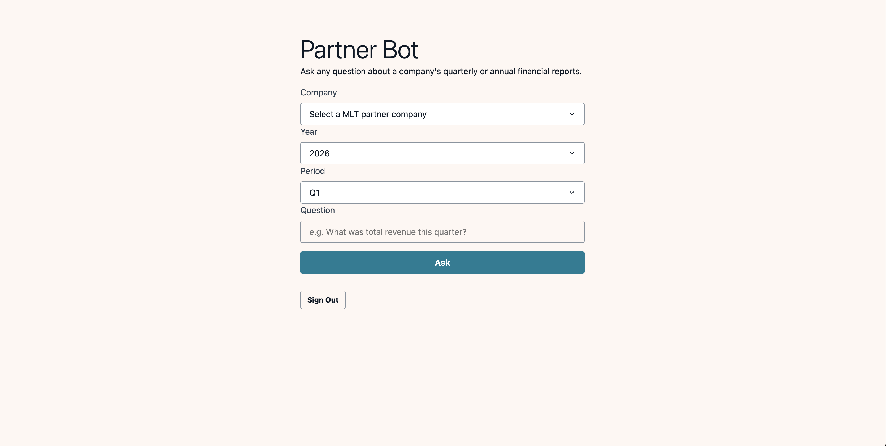

# SEC Filing RAG Application

A full-stack Retrieval-Augmented Generation (RAG) application that answers financial questions using real SEC 10-Q and 10-K filings. Users ask a question about a public company financials, and the system retrieves the actual SEC filing, extracts the relevant text, and uses Claude AI to generate a grounded answer citing figures directly from the source document.

Built as part of the MLT (Management Leadership for Tomorrow) GenAI Course.

## Demo

## Tech Stack

**Backend:** Python 3.12, AWS Lambda, AWS CDK, AWS SAM, AWS Bedrock (Claude Sonnet 4.5 via Converse API), SEC EDGAR API, API Gateway HTTP API with JWT authorizer

**Frontend:** React 18 + TypeScript, AWS Amplify Gen 2, Amazon Cognito (JWT auth), Vite

## How It Works

1. User selects a company, year, period (Q1-Q4 or FY), and types a question
2. Frontend authenticates via Cognito and sends the request with a JWT token
3. API Gateway verifies the token, routes to the Edge Lambda
4. Edge Lambda validates the request and invokes the Core Lambda
5. Core Lambda looks up the company CIK, finds the correct 10-Q or 10-K filing, downloads the HTML, strips it to clean text, and calls Claude via Bedrock Converse API with temperature=0
6. The grounded answer is returned with metadata (token counts, latency, source filing URL)

## Project Structure

- backend-sam/ - SAM-deployed Lambdas for SEC ticker refresh and document retrieval
- backend-cdk/ - CDK-deployed inference pipeline with Edge Lambda, Core Lambda, API Gateway, and Cognito auth
- frontend/ - React app with Amplify Authenticator and Cognito sign-in

## Key Concepts

- RAG (Retrieval-Augmented Generation) - model answers only from retrieved document context, reducing hallucination
- Edge Lambda pattern - separates request validation from core business logic
- Token budgeting - reserves 80% of model context window for filing text

## Author

Roberto Ledesma - https://github.com/rledesmatoledo
